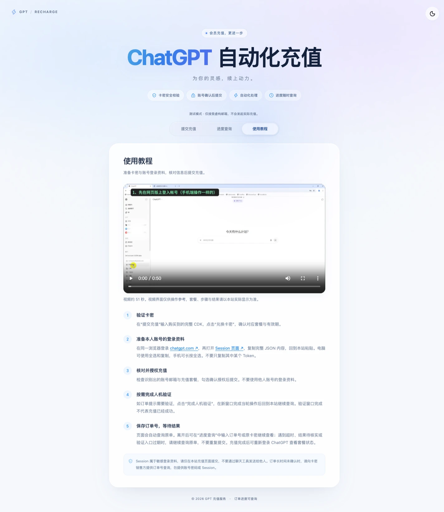
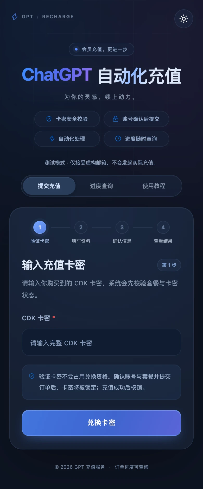

# GPT 卡密兑换站

[](LICENSE)
[](#部署环境)
[](#部署环境)

轻量的 ChatGPT 卡密兑换网站，使用 **PHP + MySQL + 原生 HTML/CSS/JS**，支持卡密发放、充值、进度查询和后台管理，内置使用教程视频、深浅主题与移动端布局。运行无需 Composer、Node、Redis 或队列服务。

**在线演示：[https://xvvs.cn/](https://xvvs.cn/)** · [部署说明](#服务器部署) · [卡台对接说明](#卡台对接说明) · [适配其他卡台](#适配其他卡台)

**默认使用模拟接口，不会发起真实充值。** Orbitcard 接入代码已完成，真实密钥联调与支付尚未验证，启用方式见下文。

## 功能

- **卡密兑换**：先验证卡密、确认套餐与账号，再提交订单；成功后核销。
- **进度查询**：通过订单号或原卡密查询原单，支持处理进度与人机验证提示。
- **后台管理**：生成、导出、禁用卡密，查看订单与审计记录。
- **页面体验**：四步兑换流程、深浅主题、响应式布局及内置教程视频。
- **通道隔离**：内置 Mock 演示通道及 Orbitcard 适配代码，默认关闭真实接口与真实下单。

## 页面预览

以下截图于 **2026-10-23** 截取自 [在线演示站](https://xvvs.cn/)。截图时站点处于测试模式，仅展示界面与操作入口，不代表真实充值已验证。

### 桌面首页


<details>
<summary>进度查询 · 深色模式</summary>


</details>

<details>
<summary>使用教程 · 视频与操作步骤</summary>



</details>

<details>
<summary>移动端 · 深色模式</summary>



</details>

## 卡台对接说明

**目前仅对接了 Orbitcard 这一个真实卡台，尚未对接或验证其他卡台。** `mock` 是本地模拟通道，不属于其他卡台接入。

- 卡台：[Orbitcard](https://orbitcard.cc/)
- 注册入口：[使用邀请码注册 Orbitcard](https://orbitcard.cc/register/7MF6B5S37E)
- 邀请码：`7MF6B5S37E`

> **非推广声明：** 提供上述链接仅为说明本项目当前对接的卡台。Orbitcard 注册必须使用邀请码，因此附上带邀请码的注册入口；该链接并非广告推广，也不代表本项目对平台服务作出担保。

Orbitcard 的 API 凭证、支付卡、套餐与权限需自行准备，配置步骤见 [Orbitcard 接入说明](docs/orbitcard-deploy.md)。源码已包含适配实现，但仍需完成自己的真实接口联调与支付验证。

### 适配其他卡台

**可以参考本项目源码对接其他卡台。** 各平台的鉴权、下单、查单和状态字段可能不同，需要按目标平台的 API 文档开发适配，不能仅更换接口域名或密钥。

| 源码入口 | 参考用途 |
| --- | --- |
| [`app/Upstream.php`](app/Upstream.php) | 上游接口约定：套餐准备、创建订单、查询和验证 |
| [`app/OrbitcardClient.php`](app/OrbitcardClient.php) | Orbitcard 的签名、HTTP 请求、错误与重试处理 |
| [`app/OrbitcardUpstream.php`](app/OrbitcardUpstream.php) | 套餐映射、下单、查单、归属核验与状态转换 |
| [`app/bootstrap.php`](app/bootstrap.php) / [`app/Core.php`](app/Core.php) | 通道配置校验、实例装配、订单通道路由与核销逻辑 |
| [`config.example.php`](config.example.php) / [`.env.example`](.env.example) | 配置结构和服务端环境变量示例 |
| [`tests/orbitcard.php`](tests/orbitcard.php) | 离线协议与订单状态测试参考 |

接入新卡台时，除实现 `Upstream` 外，还需调整配置校验、前端通道判断及订单路由；当前这些位置包含 `mock` / `orbitcard` 的判断，并非即插即用的多卡台插件系统。应保留原单查询、幂等处理、结果不明时锁卡，以及成功且账号/套餐一致后才核销的规则。现有离线测试不代表其他卡台已兼容。

## 部署环境

- PHP **8.5.12+**（CLI 和 PHP-FPM），扩展：`pdo_mysql`、`session`、`filter`、`curl`、`openssl`。
- MySQL **8.4**，使用 InnoDB。
- Nginx、域名及 HTTPS 证书。

## 服务器部署

以下以 `/var/www/gpt-redeem` 为例；使用宝塔等面板时，按实际目录、PHP-FPM 用户和 socket 修改。

### 1. 下载源码

```sh
git clone https://github.com/zcjunblog/gpt-redeem.git /var/www/gpt-redeem
cd /var/www/gpt-redeem
```

也可在 GitHub 点击 **Code → Download ZIP**，下载后上传解压。`public/media/` 内的视频和封面需一起上传。

### 2. 创建 MySQL 数据库

在 MySQL 管理终端执行，替换示例密码：

```sql
CREATE DATABASE gpt_redeem CHARACTER SET utf8mb4 COLLATE utf8mb4_bin;
CREATE USER 'gpt_redeem'@'localhost' IDENTIFIED BY '替换为随机数据库密码';
GRANT SELECT, INSERT, UPDATE, DELETE, CREATE, INDEX, REFERENCES, ALTER
ON gpt_redeem.* TO 'gpt_redeem'@'localhost';
```

### 3. 填写配置

```sh
cp config.example.php config.local.php
```

编辑 `config.local.php`，填写以下内容：

| 配置 | 填写内容 |
| --- | --- |
| `app_url` | 网站完整地址，如 `https://recharge.example.com`，末尾不加 `/` |
| `database` | MySQL 地址、端口、库名、用户名和密码 |
| `admin_user` | 后台用户名 |
| `admin_hash` | 下方命令生成的密码哈希 |
| `provider` | 先保持 `mock`，用于模拟测试 |

在 **Bash** 中输入至少 16 个字符的后台密码，并把输出哈希填入 `admin_hash`：

```bash
read -rs -p '管理员密码（至少16字符）: ' REDEEM_ADMIN_PASSWORD
printf '%s' "$REDEEM_ADMIN_PASSWORD" | php scripts/password.php
unset REDEEM_ADMIN_PASSWORD
```

登录时使用自己输入的原始密码。配置文件放在 `public/` 外，不提交到 GitHub。

### 4. 初始化与目录权限

```sh
php scripts/setup.php
```

脚本会自动建表；模拟模式首次空库生成的测试卡密保存在 `data/demo-codes.txt`。重复执行不会覆盖已有配置或数据。

让 PHP-FPM 可以读取配置、写入 `data/`。以下假设其用户和组为 `www-data`，**请按服务器实际情况替换**：

```sh
sudo chgrp www-data config.local.php
sudo chmod 640 config.local.php
sudo chown -R www-data:www-data data
sudo chmod 700 data
```

### 5. 配置 Nginx 和 HTTPS

使用仓库中的 [Nginx 配置示例](deploy/nginx.conf.example)，替换域名、证书路径、项目路径和 PHP-FPM socket，然后执行 `nginx -t` 并重载 Nginx。

**网站根目录设为 `/var/www/gpt-redeem/public`，动态请求交给项目根目录的 `router.php`。** 请使用上述示例，不能仅设置根目录后套用普通 PHP 配置。`app_url` 必须与访问域名及 HTTPS 协议一致。

PHP-FPM 建议设置 `display_errors=Off`、`log_errors=On`、`zend.exception_ignore_args=On`、`expose_php=Off`。不要记录充值接口的请求体和响应体。

### 6. 检查部署

- 首页：`https://你的域名/`
- 后台：`https://你的域名/admin.php`
- 健康检查：`https://你的域名/health`，应显示 `database: mysql`、`provider: mock`、`live_enabled: false`。

登录后台，生成模拟卡密，用虚构邮箱 `demo@example.com` 跑通兑换、查询和卡密核销，再检查教程视频能否播放。

## 启用 Orbitcard 真实接口

在 `config.local.php` 中将 `provider` 改为 `orbitcard`，确认 `orbitcard.plans` 的套餐映射，并在 **PHP-FPM 环境**中配置：

| 环境变量 | 说明 |
| --- | --- |
| `ORBITCARD_API_KEY` / `ORBITCARD_API_SECRET` | Orbitcard API 凭证 |
| `ORBITCARD_CARD_ID` | Orbitcard 有效支付卡 ID |
| `ORBITCARD_MAX_SERVICE_FEE` | 每单可接受的最高平台服务费，USDT 十进制数 |
| `ORBITCARD_ENABLED` | `1` 允许访问真实接口，默认 `0` |
| `ORBITCARD_ALLOW_CREATE` | `1` 允许真实充值，默认 `0` |

**两个开关都为 `1` 才允许真实充值，源码默认保持关闭。** 密钥只从环境变量读取；`.env.example` 是变量清单，程序不会自动加载 `.env`。PHP-FPM 可用 `env[变量名] = 值` 配置并重载，终端 `export` 不会自动传给 FPM。Pro 套餐映射需确认后再填写。

执行 `php scripts/orbitcard-check.php` 可离线检查配置，不发起网络请求。支付卡、权限、只读目录检查及正式启用步骤见 [Orbitcard 接入说明](docs/orbitcard-deploy.md)。

## 本地运行与后续维护

已配置 MySQL 后，可用 PHP 内置服务器进行本地测试（不用于公网）：

```sh
php scripts/setup.php
php -S 127.0.0.1:3100 -t public router.php
```

本地将 `app_url` 设为 `http://127.0.0.1:3100`，保留 `provider: mock`。现有 Mac 开发环境也可直接运行 `sh start.sh`。

更新前备份 MySQL、`config.local.php` 和 `data/`，更新代码后运行 `php scripts/setup.php` 补充数据库字段。服务器私有配置和数据不在 Git 仓库中，本机 `.runtime/` 也不需要上传。

从旧 SQLite 迁移时，**不要先初始化或生成测试卡**，请按 [MySQL 部署与迁移说明](docs/mysql-deploy.md) 操作。代码测试和离线接口验证记录见 [验证说明](docs/orbitcard-verification.md)。

## 开源许可

本项目源码采用 [MIT License](LICENSE)，可学习、修改、分发及商用，分发时请保留版权与许可声明。欢迎通过 Issue 反馈问题或提交 Pull Request 完善卡台适配。

页面所用 Lucide 图标的第三方许可见 [`docs/lucide-LICENSE`](docs/lucide-LICENSE)。第三方平台名称、商标及服务权益归各自权利人所有。
